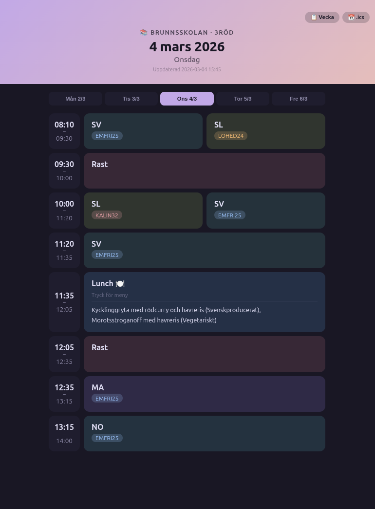

# Skola24 Schema

[](https://klppl.github.io/lagom-license/)

Statisk sida som visar schemat för en klass, hämtat från Skola24. Stödjer skolmaten.se för lunchmeny, färgteman och ICS-kalender.

## Funktioner

- **Dagsschema** - Mobilvänlig vy med tid, ämne, lärare och sal. Klicka på dagknapparna för att byta dag.
- **Veckoschema** - Separat sida med hela veckans schema i kolumner, med dubbellektioner sida vid sida.
- **Lunchmeny** - Hämtas från skolmaten.se. Tryck på Lunch-kortet för att expandera dagens rätter.
- **ICS-kalender** - `calendar.ics` för prenumeration i Google/Apple Kalender (30 dagar framåt).
- **Färgteman** - 8 inbyggda teman: default, catppuccin-mocha, dracula, nord, gruvbox, tokyo-night, rose-pine, everforest.
- **Färgkodning** - Ämnen och lärare får konsekventa färger som sparas mellan körningar.



## Kom igång

Kräver Python 3.12+ och [uv](https://docs.astral.sh/uv/).

### 1. Konfigurera

Kör det interaktiva setup-scriptet som frågar efter kommun, skola och klass:

```bash
uv run python configure.py
```

Scriptet frågar dig steg för steg:
1. Ange kommun (t.ex. `orebro`)
2. Välj skola från listan
3. Välj klass från listan

Resultat sparas i `config.toml`.

### 2. Valfritt: Aktivera skolmaten

Lägg till i `config.toml`:

```toml
[skolmaten]
enabled = true
school = "brunnskolan"
```

Skolnamnet är det som står i URL:en på skolmaten.se (t.ex. `https://skolmaten.se/brunnskolan/`).

### 3. Valfritt: Byt färgtema

Ändra temat i `config.toml`:

```toml
[theme]
active = "rose-pine"
```

Tillgängliga teman: `default`, `catppuccin-mocha`, `dracula`, `nord`, `gruvbox`, `tokyo-night`, `rose-pine`, `everforest`. Temafärgerna definieras i `colors.toml` och går att anpassa.

### 4. Bygg

```bash
uv run python build.py
```

Genererar `docs/index.html`, `docs/vecka.html` och `docs/calendar.ics`.

## Driftsättning

De genererade filerna hamnar i `docs/` som GitHub Pages kan serva direkt.

Kör `build.py` via cron eller CI för att hålla schemat uppdaterat.

### Google Kalender-prenumeration

1. Publicera sidan och kopiera URL:en till `calendar.ics`
2. I Google Kalender: **Andra kalendrar (+)** -> **Från webbadress**
3. Klistra in URL:en
4. Google hämtar uppdateringar automatiskt

## Projektstruktur

```
build.py           # Bygger statiska filer till docs/
configure.py       # Interaktiv setup - skapar config.toml
skola24.py         # Skola24 API-klient (async)
skolmaten.py       # Hämtar lunchmeny från skolmaten.se RSS
ical.py            # ICS-kalendergenerering
config.toml        # Konfiguration (skola, tema)
colors.toml        # Färgkodning och temadefinitioner
templates/
  index.html       # Dagsschema (Jinja2-template)
  vecka.html       # Veckoschema (Jinja2-template)
```

## Konfigurationsfiler

### config.toml

Innehåller Skola24-inställningar (genereras av `configure.py`), skolmaten-integration och aktivt tema.

### colors.toml

Sparar färgkodning för ämnen och lärare så att färgerna är konsekventa mellan körningar. Innehåller även alla temadefinitioner. Redigera manuellt för att ändra färger på enskilda ämnen eller teman.
